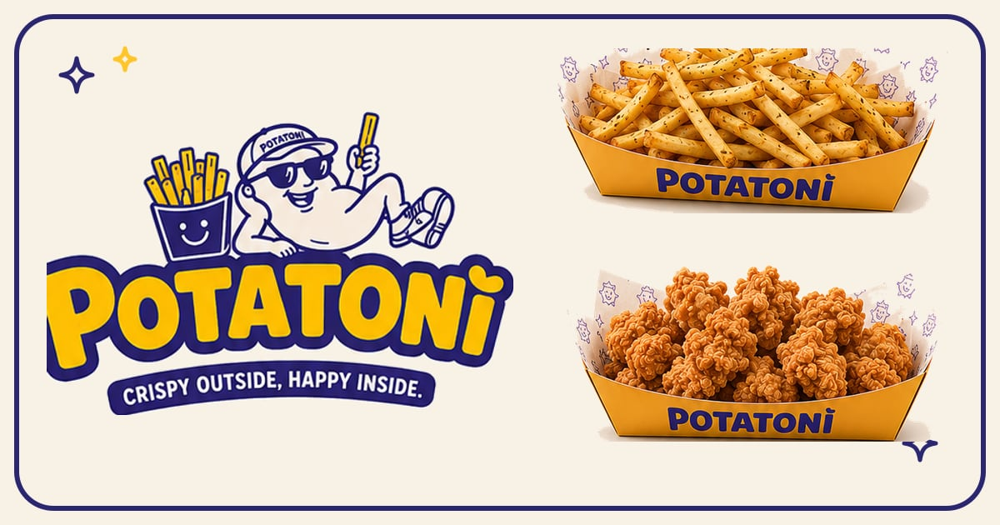
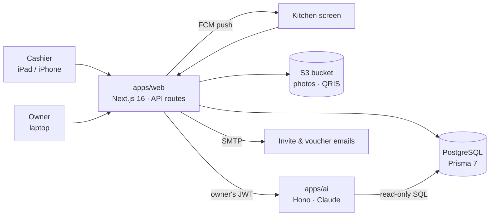
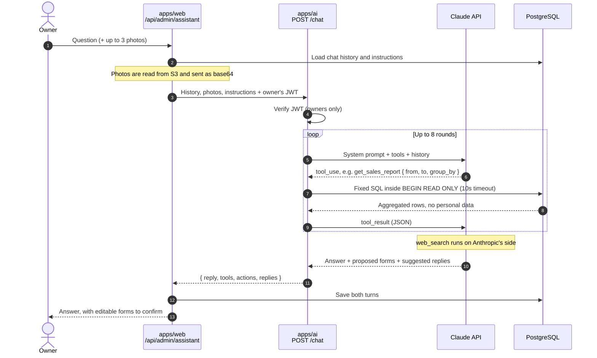

<div align="center">



# Potatoni

**The point of sale, kitchen screen and owner dashboard for a fries & chicken-bites stall, with an AI assistant built in.**

[](https://github.com/maulanaadil/potatoni/actions/workflows/ci.yml)
[](LICENSE)


[Live app](https://potatoni.aallatif.my.id) (staff login) · [Features](#features) · [How it works](#how-it-works) · [Getting started](#getting-started) · [License](#license)

</div>

## Overview

Potatoni is a real food stall that sells fries and chicken bites at bazaars and events. This repository is the software that runs it day to day. It is a single app that three people use differently:

- **The cashier** takes orders on an iPad or iPhone and charges by QRIS or cash.
- **The kitchen** sees only paid orders, what to cook, and ticks them off.
- **The owner** follows sales, stock costs, vouchers and locations from a dashboard, and can ask an AI assistant about the business.

It is built around how the stall works, not around a generic POS:

- **The menu flow matches the menu board:** size → cut → two free seasonings → add-ons.
- **QRIS payments need no gateway.** The stall's printed QRIS is turned into a QRIS with the amount embedded for every order, so there are no gateway fees.
- **Profit is real profit.** Stock purchases (potatoes, oil, chicken) are recorded next to sales.
- **Sales are tracked per location,** so the owner can see whether a bazaar was worth the fee.
- **Vouchers are a marketing channel.** Customers claim them from a QR poster on their own phone, and the cashier redeems them at the register.
- **It installs as an app (PWA)** on phones, tablets and laptops, with push notifications when an order is paid.

## Features

- **Register (`/`)**: cashiers sell from the menu board (size → cut → 2 free seasonings → add-ons) and charge by QRIS or cash.
- **Orders (`/orders`)**: today's orders, with payment for any that are still pending.
- **Purchases (`/purchases`)**: record stock buys (potatoes, oil, chicken…) so the owner sees real profit.
- **Kitchen (`/kitchen`)**: the kitchen screen. Nothing but paid orders waiting to be cooked, with sizes, seasonings and notes, ticked off as each one leaves the fryer.
- **Dashboard (`/dashboard`)**: owner-only overview (sales vs purchases), orders, products, seasonings & add-ons, purchases, the full activity log, and team accounts.
- **Assistant (`/dashboard/assistant`, and a launcher on every dashboard page)**: an internal AI marketer and personal assistant (Claude Haiku by default). It reads the business data read-only and answers questions about sales, best sellers, upcoming bazaars and promos.
  - Photos: send a picture of a receipt or an event poster and it fills in the purchases or the location for you to confirm. Nothing is saved until you press **Record** or **Add**.
  - History: each owner's chats are saved and can be reopened or deleted.
  - Instructions: the assistant's role, business context and style are edited under **Assistant → Instructions**. The fixed safety rules are shown there too, read-only.
  - It runs as its own service in [`apps/ai`](apps/ai/README.md).

Built for laptop, iPad (portrait and landscape) and iPhone.

## How it works



An order, from the counter to the fryer:

1. The cashier builds the order on the register. The client sends only product and modifier ids, and the server prices everything again from the database.
2. The register shows a QRIS with the exact amount, or the cashier takes cash.
3. When the money arrives, the cashier taps **Payment received**. The order is marked paid and written to the activity log.
4. A push notification goes to the owner and the cashier (amount, method, location) and another to the kitchen (what to cook).
5. The kitchen screen lists the order until it is ticked off.

### How the assistant reads the database

The assistant is retrieval-augmented, but without a vector store or embeddings. Claude retrieves live numbers by calling tools, and each tool is a fixed, parameterised SQL query that `apps/ai` runs against the same Postgres as the web app. The model picks the tool and its arguments (date range, grouping) but never writes SQL.



| Tool | Tables it reads |
| --- | --- |
| `get_business_overview` | `Product`, `ProductVariant`, `Modifier`, `Order`, `Purchase`, `Customer`, `VoucherCampaign` |
| `get_sales_report` | `Order`, `OrderItem` |
| `get_product_performance` | `OrderItem`, `Order` |
| `get_locations` | `Location`, `Order`, `Purchase` |
| `get_costs` | `Purchase`, `Order` |
| `get_voucher_performance` | `VoucherCampaign`, `VoucherClaim`, `Order` |
| `get_customer_insights` | `Customer`, `VoucherClaim` (counts only) |

Why it's safe to point an LLM at the business database:

- **Postgres enforces read-only access.** Every tool runs in a `READ ONLY` transaction, so the database rejects any write. That also makes retrying a dropped connection safe.
- **No personal data leaves the database.** Customer names, emails and phone numbers are never selected.
- **Writes need the owner.** `propose_purchases` and `propose_location` only fill in a form. The data is saved through the normal web API when the owner presses **Record** or **Add**.

The tools and prompts are covered in more detail in [`apps/ai/README.md`](apps/ai/README.md). The reasoning behind both diagrams, and the trade-offs, are in [`docs/architecture.md`](docs/architecture.md).

### Repository layout

```
apps/
  web/     Next.js app: register, kitchen, dashboard, API routes, Prisma schema
  ai/      Assistant service: Hono + Anthropic SDK, read-only tools (see apps/ai/README.md)
packages/
  eslint-config/       shared ESLint config
  typescript-config/   shared tsconfig
```

It is a pnpm + Turborepo monorepo. `pnpm dev`, `pnpm build`, `pnpm lint` and `pnpm check-types` run across every workspace.

## Stack

| Layer | Choice |
| --- | --- |
| App | Next.js 16 (App Router, route handlers, `src/proxy.ts` auth gate), React 19 |
| Styling | Tailwind CSS v4 (tokens in `src/app/globals.css`), Base UI dialogs/drawer, Sonner toasts, NumberFlow |
| Data fetching | SWR on the client (server-rendered `fallbackData`, polling on live screens) |
| Database | PostgreSQL (Prisma Postgres) via Prisma 7 + `@prisma/adapter-pg` |
| Auth | JWT (HS256, `jose`) in an httpOnly cookie, also accepted as `Authorization: Bearer` |
| Storage | S3-compatible bucket (Tigris `t3.storage.dev`), streamed through `/api/media/*` |
| Image editing | `react-easy-crop` in `ImageEditor`: crop, aspect presets, zoom, rotate, straighten, flip, brightness/contrast/saturation, exported in the browser as WebP (max 1600px) before upload |
| Charts | Recharts, with a palette checked by the dataviz validator |
| AI assistant | `apps/ai`: Hono service, Claude (Anthropic SDK) tool use, read-only SQL tools |
| Notifications | Firebase Cloud Messaging web push, sent from `firebase-admin` and drawn by `public/sw.js` |

## Roles

| Role | Sees |
| --- | --- |
| **Owner** (`ADMIN`) | everything: register, orders, purchases, kitchen and the dashboard |
| **Cashier** (`CASHIER`) | register, orders and purchases |
| **Kitchen** (`KITCHEN`) | only `/kitchen`; every other page bounces back there (`src/proxy.ts`) |

Roles live on the JWT, so the gate in `src/proxy.ts` (pages) and `requireApiSession` (API routes) both read the same value. Kitchen accounts can read today's orders but can't create, pay for or cancel one.

## Notifications

When a cashier confirms a payment (QRIS or cash), `payOrder` sends two push notifications with Next's `after()`, so the register never waits for them:

- **Owner and cashier:** `PTN-… paid · Rp 25.000 · QRIS · Bazaar name`.
- **Kitchen:** what to cook — every line with quantity, size and seasonings, plus the order note.

Setup:

1. Firebase console → new project → add a **Web app**, and copy the config into `NEXT_PUBLIC_FIREBASE_*`.
2. **Cloud Messaging → Web configuration → Generate key pair** → `NEXT_PUBLIC_FIREBASE_VAPID_KEY`.
3. **Service accounts → Generate new private key** → `FIREBASE_CLIENT_EMAIL` and `FIREBASE_PRIVATE_KEY` from the JSON.

Notes:

- Each device turns alerts on itself ("🔔 Turn on alerts" in the header); the token is stored per user in `PushDevice` and dead tokens are dropped when Firebase rejects them.
- Messages are **data-only**, so `public/sw.js` decides how the notification looks and a device never shows a duplicate.
- The service worker only registers in production builds, so push does not work with `next dev`. Use `next build && next start`.
- iPhone needs the app installed to the Home Screen first (iOS 16.4+). Android and desktop Chrome work in a normal tab.
- Without the Firebase variables the app runs exactly as before, just without notifications.

## Payments: one QRIS, no gateway

The stall's printed QRIS (`apps/web/assets/source/qris.jpg`) is decoded once into `STATIC_QRIS_PAYLOAD` (`src/lib/qris.ts`). For every order the register turns it into a **dynamic QRIS with the amount embedded** (tag 54, recomputed CRC16), so the customer only scans and confirms. If a payer app refuses the dynamic code, the cashier can switch to the printed QRIS image. There is no payment callback, so the cashier taps **Payment received** once the incoming-payment notification shows up. Every confirmation is written to the activity log with the cashier's name.

## Database connections

The pooled Prisma Postgres connection can drop mid-query ("Connection terminated unexpectedly"). `src/lib/db.ts` keeps sockets alive and **retries read queries once** on a fresh connection. Writes are never retried, so an order can't be recorded twice. Instead the API answers `503 Lost connection to the database — please try again`.

## Head, icons & SEO

- **Icons:** `assets/source/icon.svg` (the smiling fries-box badge) is the single source. `pnpm --filter web assets:brand` builds `favicon.ico` (16/32/48), `icon.svg`, `apple-icon.png`, the manifest icons in `public/icons/` (192, 512, maskable 512), and the 1200×630 share image `opengraph-image.jpg` / `twitter-image.jpg`.
- **Install as an app (PWA):** `src/app/manifest.ts` (with Register, Orders, Dashboard and Assistant shortcuts) plus a service worker, `public/sw.js`, make the app installable and let it launch full-screen on phones, tablets and desktop.
  - The worker never caches `/api` or page HTML, so live orders, prices and customer data always come from the server.
  - It only caches Next's content-hashed static files and the app icons.
  - When a page can't load, it shows `public/offline.html`, which retries by itself when the connection returns.
  - `experimental.useOffline` (Next 16) holds failed in-app navigations until the connection returns, and `OfflineBanner` says so.
  - The worker registers in production builds only. Test it with `next build && next start`.
  - **Launch screens:** iPhone and iPad show `public/splash/*.png` (cream background, centred app icon) while the installed app opens. Android and desktop Chrome build theirs from the manifest. The devices are listed in `src/lib/splash-screens.ts`; regenerate the images with `pnpm --filter web assets:splash`.
  - **Launch animation:** in the installed app only, `LaunchSplash` repeats the launch screen's first frame, then presses the icon (scale 0.96) and fades out (about 300ms, `ease-out-strong`). Reduced motion gets a plain fade. Browser tabs never show it.
- **Not indexed:** this is a private POS behind a login, so `robots.ts` disallows everything and pages send `noindex`. Link previews (WhatsApp, Telegram) still work. Flip `robots` in `src/app/layout.tsx` and `robots.ts` if a public page is added.
- **`APP_URL` must be set when building.** Share-image URLs are baked in at build time, so set `APP_URL` (e.g. `https://potatoni.id`) in the build environment, not just at runtime.
- The auth gate (`src/proxy.ts`) lets the manifest, robots, icons and share images load without a session.

## Team invites

Owners invite people from **Dashboard → Team → Invite person**. The invitee gets an email link, valid for 7 days, where they choose a name and password. Opening the link is what verifies the email address. Only the SHA-256 of each link token is stored, so a new invite or a resend invalidates the older links. There is no direct account creation anymore.

## Vouchers & customers

- **Campaigns** (**Dashboard → Vouchers**): percent off with an optional cap, or rupiah off; a minimum spend; a claim window; a quota; and how long each voucher stays valid. Each campaign has a public link `/v/<slug>`, a downloadable QR code, and a printable A4 poster.
- **Claiming** (customers, on their phone): name, WhatsApp number (stored as `+62…`), email and an optional promo consent. The customer then enters a 6-digit code sent by email: it expires in 10 minutes, allows 5 attempts, has a 30-second resend cooldown and is capped at 5 sends. After that they get a voucher code (`PTN-XXXXXX`) with a QR, on screen and by email. Each campaign allows one voucher per email and one per phone.
- **Redeeming** (register): the cashier types the code in the cart. The discount is computed on the server when the order is created. The voucher is marked used when the order is paid, and freed again if the order is cancelled or deleted.
- **Customers** (**Dashboard → Customers**): search and WhatsApp links, plus CSV export. The default export only includes people who agreed to promos, which is what UU PDP expects for marketing; "Export everyone" includes all.

## Email (SMTP)

Set `SMTP_HOST`, `SMTP_PORT`, `SMTP_SECURE`, `SMTP_USER`, `SMTP_PASS` and `MAIL_FROM` in `apps/web/.env` (see `.env.example`). Any SMTP provider works, for example a Gmail app password, Brevo or Resend.

- **No `SMTP_HOST` in development:** emails are printed to the terminal, and the invite link or voucher code is shown on screen so the flows can still be tested.
- **No `SMTP_HOST` in production:** the API answers `503` instead of pretending the email was sent.

## Getting started

```bash
nvm use                           # Node 25 (.nvmrc)
pnpm install                      # also runs `prisma generate`
cp apps/web/.env.example apps/web/.env   # fill in DATABASE_URL, JWT_SECRET, S3_*, ADMIN_*
pnpm --filter web db:deploy       # apply migrations
pnpm --filter web db:seed         # menu from the board + owner account (ADMIN_EMAIL / ADMIN_PASSWORD)
pnpm --filter web assets:upload   # crop menu-board photos + QRIS and upload them to the bucket
pnpm dev                          # http://localhost:3000
```

In Conductor, `.conductor/settings.toml` handles the setup, and the **dev** run script starts the app on `$CONDUCTOR_PORT`. `.worktreeinclude` copies `apps/web/.env` from the main checkout into new workspaces.

### CI (`.github/workflows/ci.yml`)

CI runs on every pull request and every push to `main`. It has four parallel jobs, using Node from `.nvmrc` and pnpm from `packageManager`:

| Job | Checks |
| --- | --- |
| Dependencies | no `yarn.lock` / `package-lock.json` / `bun.lock`; `pnpm install --frozen-lockfile`; `pnpm audit --prod --audit-level high` |
| Lint | `pnpm lint` (Biome formatting/imports/lint in every workspace, then ESLint in `apps/web`, zero warnings) |
| Typecheck | `pnpm check-types` |
| Build | `pnpm build` (Prisma client + Next.js), using placeholder `DATABASE_URL`/`APP_URL`, so no secrets are needed |

- Actions are pinned to commit SHAs.
- The workflow token is read-only, and checkout doesn't keep git credentials.
- A new push cancels the run it replaces.
- Turbo runs in strict env mode, so `turbo.json` declares the build's variables: `APP_URL` is part of the cache key, and `DATABASE_URL` is passed through.
- Security overrides for transitive dependencies live in `pnpm-workspace.yaml`. Remove each one once its parent package ships the fix.

### Linting and formatting

[Biome](https://biomejs.dev) formats, sorts imports and lints every workspace from one root `biome.jsonc`. `apps/web/biome.json` extends it (`"extends": "//"`) and adds the Next.js, React and Tailwind settings. ESLint is kept only for the rules Biome doesn't have yet: the React Compiler checks from `eslint-plugin-react-hooks` and Next.js's own checks.

| Command | What it does |
| --- | --- |
| `pnpm lint` | `biome check` in each workspace plus the root config files, then ESLint in `apps/web`. Fails on any finding. |
| `pnpm format` | `biome check --write .` formats, organizes imports and applies safe fixes across the repo. |

In VS Code, install the recommended Biome extension. `.vscode/settings.json` formats on save.

### Deploy (`.github/workflows/deploy.yml`)

Every merge to `main` deploys to production at https://potatoni.aallatif.my.id, but only after CI passes on that commit.

1. CI finishes on the push to `main`.
2. **Deploy** checks out that exact commit and runs `vercel pull` (project settings plus production env vars), `vercel build --prod`, then `vercel deploy --prebuilt --prod`.
3. The job runs in the GitHub `production` environment (limited to `main`), and the deployment URL shows up on the run and under the repo's **Environments**.

Setup (once):

| Where | Name | Value |
| --- | --- | --- |
| `production` environment → secret | `VERCEL_TOKEN` | A token from https://vercel.com/account/tokens, scoped to the project's team |
| `production` environment → variable | `VERCEL_ORG_ID`, `VERCEL_PROJECT_ID` | From `.vercel/project.json` (already set) |

- Vercel's own Git deploys are off (`"git": { "deploymentEnabled": false }` in `apps/web/vercel.json`), so a merge never deploys twice or skips CI.
- Deploys queue instead of cancelling each other, so a deploy is never stopped halfway.
- To redeploy `main` without a new commit (for example after changing an env var in Vercel), use **Actions → Deploy → Run workflow**.
- Database migrations aren't part of the deploy. Run `pnpm --filter web db:deploy` against production before merging a PR that changes `schema.prisma`.

### Scripts (`apps/web`)

| Script | What it does |
| --- | --- |
| `db:migrate` | `prisma migrate dev` (create migrations while developing) |
| `db:deploy` | `prisma migrate deploy` |
| `db:seed` | Idempotent seed of products, seasonings/add-ons and the owner account |
| `db:studio` | Prisma Studio |
| `assets:upload` | Crop + upload brand/menu images (`--dry-run` writes previews to `.context/asset-preview`) |

## API

All endpoints return JSON. Errors are `{ "error": "<English message>" }`.

| Method | Path | Who |
| --- | --- | --- |
| POST | `/api/auth/login` → `{ token, user }` + cookie | public |
| POST | `/api/auth/logout` | any |
| GET | `/api/auth/me` | signed in |
| GET | `/api/menu` | signed in |
| GET / POST | `/api/orders` (today) | signed in |
| GET | `/api/orders/:id` | signed in |
| POST | `/api/orders/:id/pay`, `/api/orders/:id/cancel` | signed in (paid orders: admin only) |
| GET / POST | `/api/purchases` | signed in (date range: admin) |
| PATCH / DELETE | `/api/purchases/:id` | admin |
| CRUD | `/api/admin/products[/:id]`, `/api/admin/modifiers[/:id]`, `/api/admin/users[/:id]` | admin |
| GET / PATCH / DELETE | `/api/admin/orders[/:id]` | admin |
| GET | `/api/admin/stats`, `/api/admin/activity` | admin |
| POST | `/api/admin/uploads` (multipart image → S3 key) | admin |
| GET | `/api/media/:key*` | public (product images, QRIS) |
| GET / POST | `/api/admin/invites`; DELETE `/api/admin/invites/:id`; POST `/api/admin/invites/:id/resend` | admin |
| POST | `/api/invites/:token/accept` → creates the account and signs in | public (link from the email) |
| CRUD | `/api/admin/vouchers[/:id]` (campaigns; delete only when nothing was claimed) | admin |
| GET | `/api/admin/customers?q=&consent=1`, `/api/admin/customers/export[?all=1]` (CSV) | admin |
| POST | `/api/vouchers/:slug/claim`, `/api/vouchers/claims/:id/verify`, `/api/vouchers/claims/:id/resend` | public, rate-limited |
| GET | `/api/vouchers/check?code=&subtotal=` (discount preview) | signed in |
| GET / POST | `/api/locations` (register), `/api/admin/locations[/:id]` | signed in / admin |
| POST | `/api/admin/assistant` `{ chatId?, message, imageKeys? }` → `{ chatId, messages }` (asks `apps/ai`, saves both turns) | admin |
| GET / DELETE | `/api/admin/assistant/chats[/:id]` (your own chats only) | admin |
| PATCH | `/api/admin/assistant/messages/:id` `{ index, status }` (a proposal was recorded or dismissed) | admin |
| GET / PUT / DELETE | `/api/admin/assistant/instructions` (DELETE resets to the default) | admin |

Order prices are always recalculated on the server from the database. The client only sends variant and modifier ids. Order items snapshot names and prices, so later menu edits never rewrite sales history.

## License

The source code is released under the [MIT License](LICENSE). Copyright © 2026 Maulana Adil.

The license covers the code only. The Potatoni name, logo and mascot, the menu photos in `apps/web/assets/source/` and the stall's QRIS code (`qris.jpg`, `STATIC_QRIS_PAYLOAD` in `src/lib/qris.ts`) belong to the stall and aren't licensed for reuse. If you run this for your own business, swap in your own brand assets and QRIS before you take a payment.
